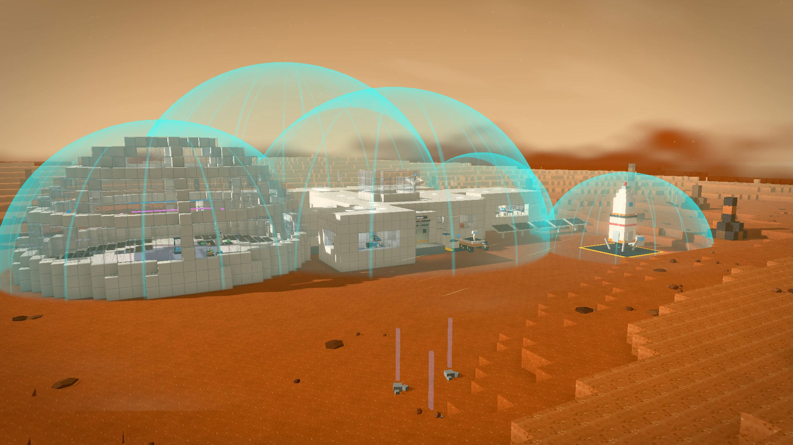
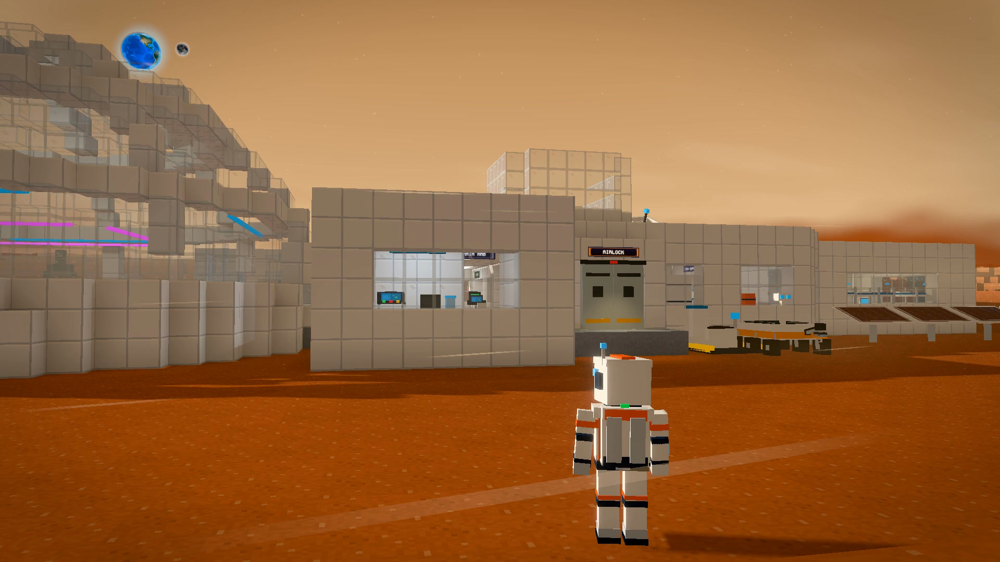
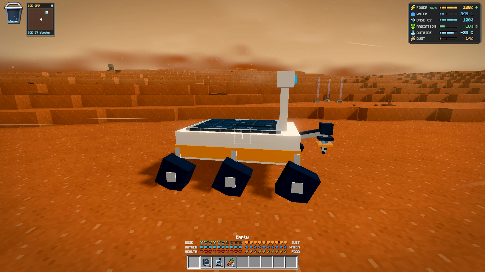
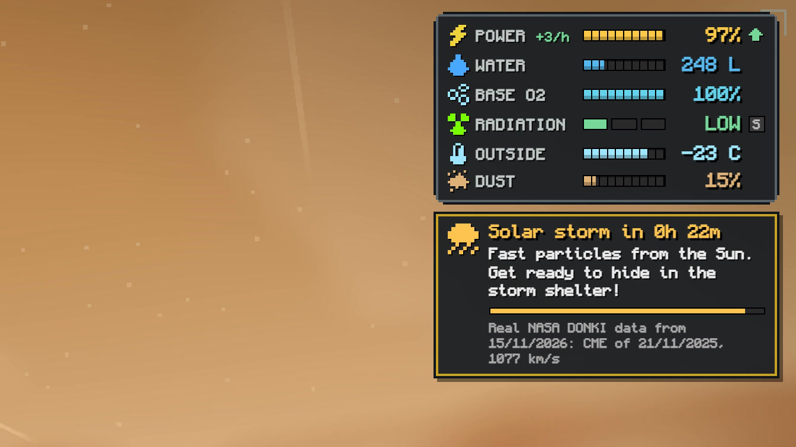
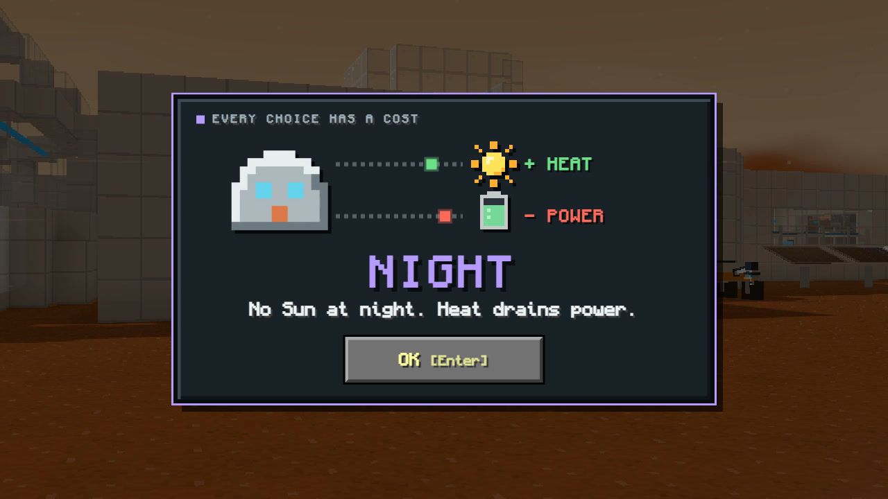
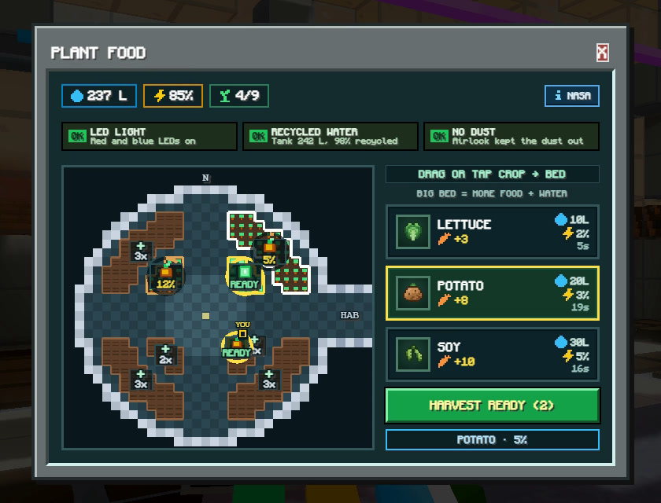
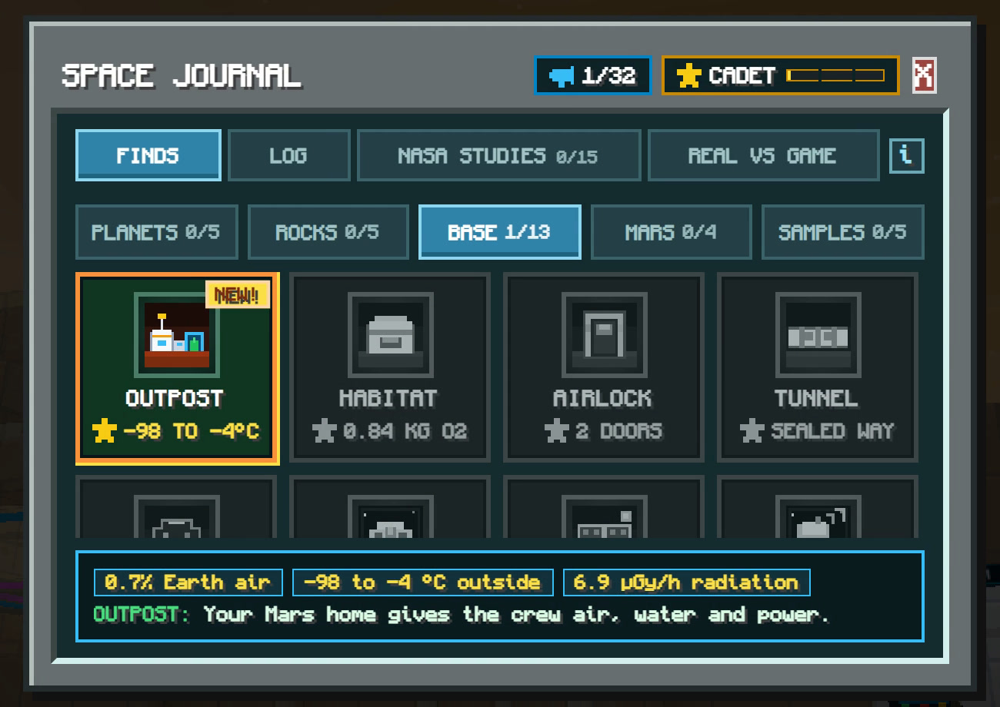

# MarsCraft

A voxel survival game where children aged 7 to 12 run an outpost on Mars and learn real engineering trade-offs: life support, power, food, radiation and the radio delay to Earth. Every useful action costs another resource.

Built for the [Build a Junior Astronaut Mission Trainer](https://www.spaceappschallenge.org/2026/challenges/junior-astronaut-mission-trainer/) challenge of the NASA Space Apps Challenge 2026.

**Play it:** https://mars-craft.vercel.app



## What is in the game

- A five-act story, from the first ice run to the launch back to Earth.
- A base to keep alive: battery, water tank, oxygen machine, greenhouse and storm shelter.
- Solar storms, dust storms, meteor impacts and marsquakes.
- A scope to scan Mars, samples to analyze and science to send home.
- English, Brazilian Portuguese and Spanish, on desktop and on touch screens in landscape.

## Screenshots

| | |
|---|---|
|  |  |
| The base, with Earth and the Moon in the Mars sky | The rover on terrain measured by HiRISE |
|  |  |
| A solar storm warning from real NASA DONKI data | Every choice has a cost |
|  |  |
| Growing food costs water and power | The journal, with NASA studies and REAL VS GAME |

## Controls

| Key | Action |
|---|---|
| `W A S D` | Move on foot, or drive the rover |
| `Shift` | Sprint |
| Mouse | Look around |
| `Space` | Jump on foot; drill or unload ice in the rover |
| Hold left click | Break blocks or harvest crops |
| Right click | Use the selected item or place a block |
| `F` | Interact with a station or object; leave the rover |
| `E` | Inventory |
| `J` | Journal |
| `F5` | Switch between first and third person |

On a phone or tablet, turn the device to landscape. The game shows a stick to move, buttons for each action and a MORE menu for the rest. The full list is in the Controls screen of the menu.

## NASA open data used

| Data | Used for | Source |
|---|---|---|
| DONKI | Solar storms that NASA predicted would reach Mars | https://ccmc.gsfc.nasa.gov/tools/DONKI/ |
| RadLab (Curiosity MSL-RAD) | Radiation dose on the surface of Mars | https://visualization.osdr.nasa.gov/radlab/ |
| OSDR | Space biology studies shown in the journal | https://osdr.nasa.gov/bio/repo/ |
| InSight Mars Weather | Temperature, air pressure and wind at the surface | https://api.nasa.gov/ |
| HiRISE DTM | Real elevation of a crater inside Gale Crater | https://www.uahirise.org/dtm/PSP_010573_1755 |

Only the DONKI space weather is loaded live, when the game opens. Everything else is saved in the repository with the date it was collected, and the game says LIVE only when the live request worked.

Game speed, battery size and storm length are scaled so a mission fits in one play session. The journal has a REAL VS GAME page that says where the game changes reality. The Sources screen in the menu lists every number and where it comes from. The same numbers are in [`docs/data/numeros-reais.md`](docs/data/numeros-reais.md) (in Portuguese).

## Run it locally

Node 22 is required.

```bash
npm install
cp .env.example .env   # optional: add a free NASA_API_KEY from https://api.nasa.gov/
npm run dev
```

Then open http://localhost:3000.

Other commands: `npm run build`, `npm run typecheck` and `npm test`.

The NASA key is only read on the server (`/api/space-weather`) and by the data scripts in `scripts/`. It never reaches the browser. Without it, the server uses NASA's shared `DEMO_KEY`, which allows about 10 requests an hour. When the live request fails, the game uses the NASA data saved in the repository.

A push to `main` deploys to Vercel through `.github/workflows/deploy.yml`.

## Project layout

- `src/` holds the game: TypeScript and Three.js, mounted by a thin Next.js shell.
- `public/` holds the game HTML, audio, textures and team photos.
- `docs/` holds the challenge text, the NASA API notes and the real numbers. Most of it is in Portuguese.
- `AGENTS.md` is the contributor guide, with the design principles and the code map.

## Credits

Team: Derick Bessa, João Pedro Moreira, Isaac Duarte, Letícia Freitas, Renan França and Lucas Rocha.

- Font: [Monocraft](https://github.com/IdreesInc/Monocraft), SIL Open Font License 1.1.
- Interface and suit sounds: [Kenney](https://kenney.nl/), CC0. The sources of 12 older gameplay WAV files are not recorded yet. The full audio inventory is in [`docs/game/audio.md`](docs/game/audio.md).
- Earth texture: NASA Blue Marble (Shaded Relief and Bathymetry), from NASA Earthdata GIBS.
- Moon texture: Lunar Reconnaissance Orbiter WAC global mosaic, from NASA Moon Trek.
- The start menu space art was generated with AI assistance. Parts of the code were written with AI assistance.

This project is not affiliated with or endorsed by NASA.
